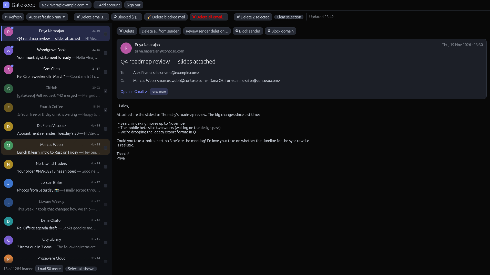

# Gatekeep

A debloated mail client for Gmail and Outlook (Outlook.com, Hotmail, Live, MSN and
Microsoft 365) on the desktop, built with Rust and egui.
It shows your inbox without clutter and filters it with rules you define, and it
can clear out unwanted mail in bulk. It never sends mail or marks it as read.



## Run

```sh
cargo run --release
```

Gmail needs nothing configured beforehand. Outlook needs a one-time Microsoft app
registration (see [Setting up Outlook sign-in](#setting-up-outlook-sign-in)). You sign
in from inside the app and pick **Gmail** or **Outlook / Hotmail** on the sign-in form.

## Signing in to Gmail

Gatekeep connects to Gmail over IMAP (`imap.gmail.com:993`, TLS) with your Gmail
address and an **App Password**. Google doesn't accept your normal password for IMAP.

1. Turn on [2-Step Verification](https://myaccount.google.com/signinoptions/two-step-verification)
   for your Google account. App Passwords require it.
2. Create an App Password at <https://myaccount.google.com/apppasswords> (any name,
   e.g. "Gatekeep"). Google shows 16 letters; spaces don't matter.
3. In Gatekeep, enter your Gmail address and that App Password, then click **Sign in**.

This works with any Gmail account. You don't need a Google Cloud project or a
credentials file.

If you're signing in with a Google Workspace (work or school) account, your
administrator must allow IMAP access.

## Signing in to Outlook / Hotmail

Microsoft no longer accepts passwords or app passwords over IMAP, so Outlook accounts
sign in with Microsoft's own sign-in page (OAuth 2.0, device code flow):

1. On the sign-in form, choose **Outlook / Hotmail** and click **Sign in with Microsoft**.
2. Gatekeep shows a short code and a link to `microsoft.com/devicelogin`. Open the
   link in any browser, enter the code, and sign in.
3. Gatekeep finishes on its own and detects your address. It never sees your password.

Gatekeep connects to `outlook.office365.com:993` (TLS). IMAP must be on for the account:
in Outlook on the web, go to **Settings → Mail → Forwarding and IMAP** and turn on
**Let devices and apps use IMAP**. For a work or school (Microsoft 365) account, your
administrator must allow IMAP and may have to approve the app.

### Setting up Outlook sign-in

Microsoft sign-in needs an app registration (a free "client ID"). You enter it in the
Outlook sign-in form; nothing is read from build settings or config files. Create one once:

> **Personal accounts need their own tenant to register an app.** If you open the Entra
> admin center with a personal Microsoft account (Outlook, Hotmail, Live), you are placed
> in Microsoft's shared "Microsoft Services" tenant and see *"Selected user account does
> not exist in tenant 'Microsoft Services'"*. Create your own tenant first (for example by
> signing up for a free Azure account, which may ask for a card), or register the app
> with a work or school account. This only affects registering the app: any personal
> account can sign in to Gatekeep with the resulting client ID, since the app allows
> personal Microsoft accounts (step 2).

1. Go to <https://entra.microsoft.com> → **App registrations** → **New registration**.
   Any Microsoft account can do this.
2. Name it (e.g. "Gatekeep"). Under **Supported account types**, choose
   **Accounts in any organizational directory and personal Microsoft accounts**.
   Leave the redirect URI empty and click **Register**.
3. Under **Authentication**, set **Allow public client flows** to **Yes** and save.
4. Under **API permissions**, add the delegated **Microsoft Graph** permissions
   `IMAP.AccessAsUser.All`, `offline_access`, `openid`, `email` and `profile`.
5. Copy the **Application (client) ID** from **Overview** and paste it into the
   **Microsoft app client ID** field on the Outlook sign-in form.

The form shows these steps too. Each Outlook account stores the client ID it signed in
with alongside its refresh token, so signed-in accounts reopen without asking again, and
adding another Outlook account pre-fills the field.

## Several accounts

To add another account (Gmail or Outlook), click **+ Add account** in the top bar.
Once several accounts are signed in, pick the one to show from the account menu in
the top bar. Each account has its own inbox, but the blocked-senders list is shared
by all of them.

Choose **All accounts** in the same menu to see every account's inbox in one list,
newest first: the newest 50 emails from each account. Each row shows which account it
belongs to, and deleting (one email, ticked emails, or "Delete all from sender") acts
on that email's own account. **Delete emails…**, **Delete all email…** and **Sign out**
need a single account, so pick one first. **Load more** isn't offered in this view.
Gatekeep remembers the choice for the next start.

### What Gatekeep changes

Reading never changes anything: Gatekeep opens the inbox with IMAP `EXAMINE`
(read-only) and fetches bodies with `BODY.PEEK`, so nothing is marked as read.

The only change Gatekeep ever makes is moving mail to Gmail's **Trash** or
Outlook's **Deleted Items**, and only when you ask it to:

- **🗑 Delete** on a message (or the Delete key) trashes that message.
- **🗑 Delete emails…** trashes every email in your account matching a filter:
  sender, subject, age, "only in Inbox", and/or (Gmail only) any extra
  [Gmail search terms](https://support.google.com/mail/answer/7190). It shows how
  many emails match before you confirm. An empty filter is never allowed.
- **🗑 Delete all email…** trashes every email in the account shown. You must type
  the address to confirm, and a progress bar blocks the rest of the window until it
  finishes. Gmail: everything in All Mail (Spam is not included). Outlook: every folder
  except Deleted Items, Junk and Outbox.
- **Checkboxes**: tick the boxes on the right of the message list, then
  **🗑 Delete N selected** trashes them. **Select all shown** ticks everything in the
  current view.
- **⛔ Blocked senders**: block a single sender or a whole domain (**⛔ Block sender** /
  **⛔ Block domain** in the reading pane, or type an address or domain in the Blocked
  window). A blocked domain also covers its subdomains, and Gatekeep warns before you
  block a public provider like gmail.com. Mail from blocked addresses or domains is trashed on
  every refresh in every signed-in account, including mail already in your account. This runs only while
  Gatekeep is open (use auto-refresh to make it automatic); to block on the server
  even when Gatekeep is closed, create a filter in Gmail's settings or add a
  blocked sender in Outlook's settings.

Gmail keeps Trash for 30 days, so anything deleted by mistake can be restored
from Trash in Gmail until then. In Outlook, deleted mail can be restored from
Deleted Items until that folder is emptied.

#### How searches differ between Gmail and Outlook

Gmail runs searches on Google's servers across **All Mail**. Outlook has no All Mail
and doesn't understand Gmail's search syntax, so for Outlook accounts Gatekeep searches
every folder except Deleted Items and Junk (or only the Inbox, if you ask). Outlook's
server-side search is fuzzy, so Gatekeep re-checks each match against the message's
headers before counting or deleting it:

- a full address (`news@shop.com`) must match the sender exactly,
- a domain (`shop.com`) matches that domain and its subdomains,
- anything else (e.g. `Amazon`) matches part of the sender's name or address,
- subjects match case-insensitively, and "older than" uses the message's Date header.

## Loading mail

Gatekeep loads the newest 50 emails, and **Load 50 more** fetches older ones.
Refresh only downloads new mail. The page size is `page_size` in `config.toml`.

### Where credentials are stored

Your signed-in addresses, Gmail App Passwords and Microsoft sign-in (refresh)
tokens are stored in your OS keychain (Secret
Service on Linux, Keychain on macOS, Credential Manager on Windows). If no keychain
is available, they fall back to `account.json` in the config directory with `0600`
permissions, and the UI shows a ⚠. **Sign out** removes the shown account's
credentials; signing out of the last account deletes them all. Microsoft access
tokens are kept in memory only.

On Linux the keychain needs a running Secret Service, such as GNOME Keyring or KWallet.

To cut off Gatekeep's access completely, revoke the App Password at
<https://myaccount.google.com/apppasswords> (Gmail), or remove the app at
<https://account.live.com/consent/Manage> (personal Microsoft accounts) or
<https://myapps.microsoft.com> (work or school accounts).
